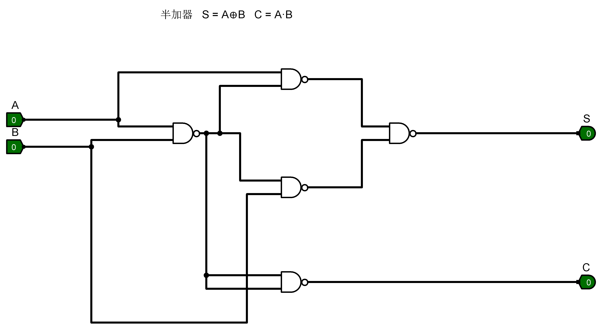

# Logisim Skill

让 AI agent **不打开 GUI** 就能生成、审计、渲染、仿真 Logisim `.circ` 电路。

[](https://github.com/HJWqa/Logisim-SKILL)
[](https://adoptium.net/)
[](LICENSE)



> 上图整条链路都是脚本跑出来的：`templates/make_circ.py` 生成 → `audit` 0 错误 →
> `render` 用 Logisim 自己的「导出图像（打印视图）」出 4 倍黑白 PNG。

`.circ` 是**明文 XML**，导线就是两个坐标，**几何即连接**。所以完全可以离开 GUI：
写 XML → 审计几何 → 用 Logisim 自己的引擎出图和仿真。

这个 skill 把整条链路封装成一个人能读、agent 能调的命令行工具。

---

## 能做什么

| 能力 | 命令 |
|---|---|
| 实测元件/引脚几何（不靠猜坐标） | `pins` |
| 几何审计（9 项：悬空端点、未接引脚、同向重叠、穿元件体、文字压线、电源短路、多驱动、文字重叠、元件同坐标） | `audit` |
| 题面约束检查（限用某芯片 / 禁用某库 / 元件数上限 / 不许留 halt） | `check` |
| 组合逻辑真值表（Logisim 自己的 Propagator） | `sim` |
| 时序逐拍波形（`--clock CLK --ticks 8`） | `sim --clock` |
| 逐根导线电平，定位红色 `E` | `values` |
| 打印视图 PNG（printerView，黑白，任意倍率） | `render` |
| 端到端自检（生成→审计→仿真→出图→电平→时序） | `selftest` |

**不能做**：判断版面好不好看、导出 PDF、用 `Clock` 元件自动跑（时序要手动输入当时钟）、
多位 `DipSwitch` 自动驱动、验证实物 74LS 的电气特性（那个用 Multisim）。

---

## 安装

### 作为 OpenCode skill

```bash
git clone https://github.com/HJWqa/Logisim-SKILL.git "<项目>/.opencode/skills/logisim"
```

或者把仓库内容拷进去后运行安装脚本：

```bash
python scripts/install.py --to <项目目录>          # → <项目>/.opencode/skills/logisim/
python scripts/install.py --to ~/.config/opencode  # 全局
```

### 依赖

- **Logisim 2.15.0.2（HUST 分支）**：几何数据是在这个版本上实测的。其他版本见下方兼容性。
- **JDK 8+**（`java` 和 `javac`）
- Python 3.8+（只用标准库）

工具会自动找 `java` / `logisim`；找不到就设环境变量：

```bash
export LOGISIM_EXE=/path/to/logisim-hust-20200118.exe
export LOGISIM_JAVA=/path/to/jdk/bin/java          # Windows: set ...
```

Windows 示例：

```bat
set LOGISIM_EXE=C:\tools\logisim-hust-20200118.exe
set LOGISIM_JAVA=C:\Program Files\Java\jdk-17\bin\java.exe
```

> `logisim.exe` 可以直接当 classpath 用（launch4j 把 jar 附在 exe 尾部），不用解包。

---

## 快速开始

```bash
cd <skill 目录>
python scripts/logisim.py env          # 确认 java / logisim 能被找到
python scripts/logisim.py build-tools # 编译 java/*.java（首次或改了 Java 源码）
python scripts/logisim.py selftest    # 装完先跑这个：6 项全 PASS 再干活
```

生成一张自己的电路：

```bash
cp templates/make_circ.py .
python make_circ.py
python scripts/logisim.py pins   新建电路.circ            # 量几何
python scripts/logisim.py audit  新建电路.circ            # 必须 0 错误
python scripts/logisim.py sim    新建电路.circ 半加器      # 真值表
python scripts/logisim.py render 新建电路.circ 半加器 out.png 4
```

时序电路（计数器 / 寄存器）：

```bash
python scripts/logisim.py sim 计数器.circ 四位计数器 500,300 --clock CLK --ticks 8
# t0 -> 0000
# t1 -> 0001
# ...
```

---

## 命令一览

| 命令 | 说明 |
|---|---|
| `logisim.py env` | 打印 java / logisim / classes 路径 |
| `logisim.py build-tools` | 编译 `java/*.java` → `java/classes` |
| `logisim.py selftest` | 生成→审计→真值表→出图→电平→时序，一条命令验全链路 |
| `logisim.py pins x.circ [电路名]` | 每个元件的 loc、外接矩形、每个引脚相对 loc 的偏移 |
| `logisim.py audit x.circ [电路名] [--cross-gap N]` | 几何审计；有问题返回码 1 |
| `logisim.py check x.circ 电路名 --require A:1:in --forbid-lib "#Arithmetic"` | 题面约束检查 |
| `logisim.py sim x.circ 电路名 [x,y ...]` | 组合真值表 |
| `logisim.py sim ... --clock CLK --ticks 8 [--combo 010]` | 逐拍波形（上升沿采样） |
| `logisim.py values x.circ 电路名 [位串] [--red]` | 逐根导线电平 |
| `logisim.py render x.circ 电路名 out.png 4` | 打印视图 PNG；`ALL outdir 2` 导出全部电路 |
| `scripts/install.py --to <项目>` | 安装到别的项目 |
| `scripts/measure_geometry.py` | 重新实测几何，覆盖 `references/02_geometry.md` |

---

## 目录结构

```
.
├─ SKILL.md                 ← agent 入口：流程、铁律、命令、检查清单
├─ references/
│  ├─ 01_circ_format.md     .circ XML 结构、属性表、子电路外观
│  ├─ 02_geometry.md        全部元件引脚几何实测表（脚本生成）
│  ├─ 03_layout.md          版面规则：走线、交叉、结点、标签、电源
│  ├─ 04_render_check.md    渲染细节 + 审计算法 + 常见误报
│  ├─ 05_pitfalls.md        症状 → 原因 → 修法
│  └─ 06_exp_notes.md       实验一~三的做法与可复用资产
├─ scripts/
│  ├─ logisim.py            命令行入口
│  ├─ measure_geometry.py   重新实测几何
│  └─ install.py            安装到别的项目
├─ java/
│  ├─ PinsDump.java         几何 → TSV（审计的数据源）
│  ├─ SimTable.java         真值表 + 逐拍时序
│  ├─ WireValues.java       逐根导线电平
│  ├─ CircExport.java       .circ → 打印视图 PNG
│  └─ PinDump / BoundsDump / LibDump / FactoryDump / ToolbarDump
├─ templates/
│  ├─ make_circ.py          生成器骨架（半加器示例，直接改）
│  └─ spdt_sel.circ         单刀双掷开关子电路（可直接当库加载）
└─ docs/                    README 用的截图
```

---

## 设计原则

1. **不猜几何**：引脚坐标一律由 `PinsDump` 从 Logisim `Component.getEnds()` 读，
   `references/02_geometry.md` 只是缓存。同一个 `NAND Gate` 在 `size=30` / `50` 下引脚位置不同，
   写死数字必然短线。
2. **不自己写求值器**：真值表用 Logisim 的 `Propagator`，天然支持多驱动、三态、子电路。
3. **不自己写渲染器**：PNG 走 Logisim「文件 → 导出图像」的同一段代码（打印视图）。
4. **结论都实测过**：文档里的数字来自 `measure_geometry.py` 或真实审计输出，
   不靠官方文档推断。
5. **用户手改过的文件先备份**：任何批量改写前先 `_备份/xxx_原因_日期.circ`。

---

## 版本兼容

| | 2.15 HUST（本 skill 实测） | 2.7.1 官方经典 | Logisim-evolution |
|---|---|---|---|
| `.circ` source | `2.15.0.2.jar` / `.exe` | `2.7.1` | 版本号更高 |
| 元件属性 | 本表所用属性齐全 | 部分不同 | 多 `decimalPoint` 等 |
| 几何 | 已实测 | 需重跑 `measure_geometry.py` | 需重跑 |
| `-tty table` | 返回码 0 但输出为空 → **用 `sim`** | 可用 | — |

换版本后先跑 `python scripts/measure_geometry.py` 重新生成几何表，再用 `selftest` 验一遍。

---

## 已知限制

- `Clock` 元件由 Logisim 仿真线程驱动，本工具不接管：时序请把时钟画成输入 `Pin` 或 1 位 `DipSwitch`。
- 多位 `DipSwitch` 不参与自动驱动（只支持 1 位）；数据位请用输入 `Pin`。
- `Tunnel` 的同名跨接是逻辑连接，几何审计看不到（它本来就检查“看起来是否连上”）。
- 审计只查几何/结构，不判断“版面好不好看”，也不验证实物电气特性。

---

## English summary

A GUI-free toolkit for Logisim (2.15 / HUST build) `.circ` files: measure pin geometry
from Logisim itself, audit schematic geometry, run truth tables and clocked sequences on
Logisim's own propagator, dump per-wire values, and export printer-view PNGs.
Install as an OpenCode skill by cloning into `<project>/.opencode/skills/logisim`.
Requires a Logisim executable and JDK 8+.

---

## License

[MIT](LICENSE)
