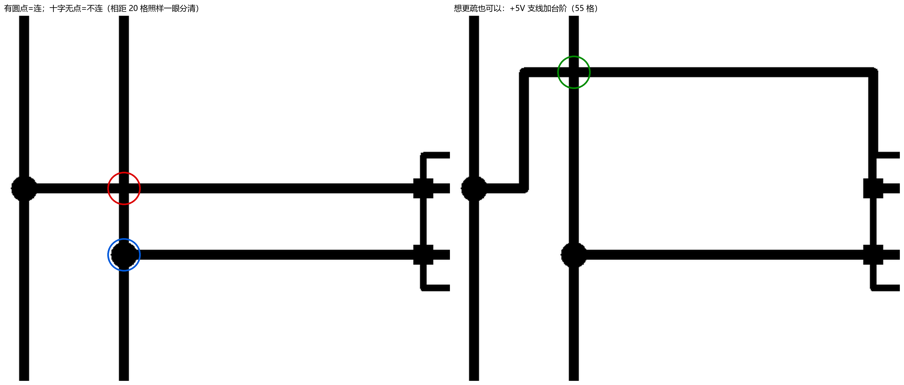

# 版面规则（画出来才清楚）

> 目标：**黑白打印出来能直接对着接线**。每个元件位置、每根线、每个标签都要有理由。

---

## 1. 画布与网格

- 坐标单位 = 画布单位，网格 10。
- **所有坐标统一加偏移**（推荐 `OX, OY = 200, 140`）：元件不要贴着左上角，
  否则 GUI 里框选、往左上拉线都点不到。
  `CircExport` 按内容包围盒裁图，多留白不会进 PNG。
- 门列间距 ≥280，行间距 ≥120。
- 输入开关之间 ≥100（要给开关名、下拉电阻、图例留位置）。
- **多位 Pin（width>1）纵向间距 ≥60**：它的值框比 1 位宽几十格，按 100 排也会蹭到。

---

## 2. 导线

- **全部正交**。分叉用竖直干线 + 水平支线，不要一根斜线拉过去。
- **T 接**（端点在另一根线内部）Logisim 自动画实心圆点 → 表示连上。
- **十字交叉**（两根线都在内部相交）没有圆点 → 表示不连。
  Logisim 的“有点=连、无点=交叉”是结构性的，**多远都判得清**；
  审计默认只统计个数（INFO），间距纯属美观，想要提示再加 `--cross-gap N`。
- 交叉点落在门名/逻辑式/引脚号上面时，读者会把它读成标签的一部分。
  宁可绕 50～80 格，把交叉留在空白处。
- 从干线下分出的长线，尽量从**下方/上方**进入门输入，别贴着门名横穿。
- 相邻两根不同网络的平行线间距 ≥30（再近视觉上像一根粗线）。
- **总线（width>1）**：N 位走一根线，拆位用 `Splitter`，不要手拉 N 根平行线。
  总线不能从任何 1 位脚上穿过——最典型的是 `Hex Digit Display` 的第二个脚
  （`loc+(10,0)`），接上就变成 `UUUU`。密集端口（RAM/ROM 的地址、数据）
  先引短线到空白处再展开。

---

## 3. 门与标签

```
        U1A  74LS00          ← y−60，字体 16，居中
        n1=(A·B)′            ← y−38，字体 14，居中
   1 ──┐
       ├──▷○── 3
   2 ──┘
```

- 门上方两行：**位号 + 芯片型号**、**逻辑式**。
- 每个端子旁用小号数字（12）标**芯片引脚号**，读者才能和实物对上：

| 位置 | 坐标（相对门 `loc`） |
|---|---|
| 第 1 输入脚号 | `(−44, −17)`，左对齐 |
| 第 2 输入脚号 | `(−44, +27)`，左对齐 |
| 输出脚号 | `(+10, −7)`，左对齐 |

- **门的 `label` 属性会画在门体里**，挤住门形 → 位号一律用单独 `Text`。
- 同一门的两个输入脚可以互换（NAND/XOR/NOR 都对称），布局时为少交叉可对调。

---

## 4. 电源与地

逻辑门符号**不显示电源脚**，所以要单独交代：

**推荐做法（多片时）**：右下角一张两行小表，不要插在门列中间。

```
芯片电源脚（每片都要接，图上不画）
U1 74LS00：14 脚 → +5 V，7 脚 → GND
U2 74LS20：14 脚 → +5 V，7 脚 → GND
```

**如果一定要画符号**：

- 一根**竖母线** + 顶上 `Power` + 旁边写 `+5 V`；各输入开关左端短横线接上去。
- `Power` 在打印视图里很小，**不写字会被误认成箭头/地**。
- 每片芯片的 14/7 脚共用，所以小图按**整片芯片**画，不要一个门画一对电源脚。

### 4.1 “全图只有一对电源/地符号”的布局

把每片芯片/每个开关的 `Power`/`Ground` 合并成**一根 +5 V 母线 + 一根 GND 母线**是好的
（更像真实电路，也少一堆小三角），代价是两条竖母线并排 30 格：

```
x=150 +5V 母线  ┐          每条 +5V 支线（y−10）都要横穿 GND 母线
x=180 GND 母线  ┘  ← 而 GND 支线（y+10）的结点就在它下方 20 格
```

因为 `SPDT_SEL` 的 T1/T2 只差 20 格，+5V 支线横穿 GND 母线的位置必然离
GND 的 T 结点 20 格。**这完全没问题**：交叉没有圆点，圆点才是连接点，
20 格（甚至 10 格）都能一眼分清，审计默认也不会提示。



> 左：红圈是交叉（不连），蓝圈是圆点（真的连上）——两者离得近也不影响判读。
> 右：如果你想要更疏的版式，给 +5 V 支线加个台阶即可（绿圈，55 格）。

**什么时候才值得动它**：纯粹是个人审美（比如想让 +5 V 和 GND 两条母线看起来更分开），
或者交叉正好落在门名/逻辑式/引脚号上。改法：

1. **支线加台阶**：+5V 支线先在离结点 ≥60 的 y 上横穿 GND 母线，再折回引脚：

   ```
   T1 (270, y−10) ← (240, y−10) ← (240, y−60) ← (150, y−60)
   ```
2. **母线放两侧**：+5V 走左上、GND 走下方水平母线，交叉自然消失，但走线变长。
3. **放弃母线**：每个开关配一对 `Power`/`Ground`，零交叉、最省事。

**另一条**：给某片芯片的“多余输入接 +5 V”供电时，不要用一根绕全图底部的长线
—— 它会横穿 GND 母线/地符号。优先用：
- 该门旁边一小段竖线接本地 +5 V 母线；或
- `Tunnel`（同名相连，但要另起图例）；
- 实在要绕，就走**地符号下方**（y 比 GND 符号还低），并在图例里说明。

---

## 5. 输入：开关 + 下拉

单刀单掷（SPST）接法：

```
+5 V ──[开关]──┬── 信号 ──→ 门电路
                │
              [10k]
                │
               GND
```

- 下拉电阻在**开关右边**（信号节点），不在 +5 V 侧。
- 开关打到 +5 V = 1，断开 = 0。
- `Pull Resistor` 是单脚元件：`facing="north"` 体向下画，旁边写 `10k`。

单刀双掷（SPDT，更好用）见 SKILL.md §7：两个掷都接确定电平，输出永远有定义，
**不需要上拉/下拉**，更接近真实拨动开关。

---

## 6. 输出

- `LED` 只有一个脚，另一端在元件内部接地；实物串 470 Ω 到 GND。
- 纯逻辑图用 `Pin(output=true)` 或 `Probe` 更干净，不要 LED。
- 图例写清楚：`○ = LED（串 470 Ω）`。

---

## 7. 图例

每张接线图末尾写一行，把符号含义一次说清：

```
图例：▲ = +5 V、⏚ = GND；方框 = SPDT_SEL 单刀双掷开关（白框上方的小拨杆是扳手）；
      ○ = LED（串 470 Ω）。
```

---

## 8. 不要做的事

- ❌ 输入 `Pin` 和开关/电源接在同一个网络上（多驱动 → `E`）
- ❌ 两个 `Pin` 上下间距 <50（引脚名会重叠）
- ❌ 把交叉画在门名/逻辑式/引脚号上（会被读成标签的一部分）
- ❌ 同向重叠的两段导线（看起来一根，点选只中一段）
- ❌ 用 TTL 整块 7400/7486 画引脚级图（不显示引脚号，顺序也不是 DIP）
- ❌ 用 GUI 保存手写 `.circ`
- ❌ 用 `Tunnel` 当电源符号（旗子会盖线）

---

## 9. 版面自检（脚本做，别肉眼）

`python scripts/logisim.py audit x.circ` 的 ERROR 项必须为 0；
`[INFO] 交叉点` 只是个数，间距不影响判读；真想更疏再加 `--cross-gap 40` 看提示。

改法思路（按优先级）：

1. 把交叉挪到空白处（加两段 10～50 的折线）
2. 把其中一根线换到另一条通道（比如走门下方而不是上方）
3. 交换同门的两个输入（对称门）
4. 换输入脚顺序（A 走内侧、B 走外侧）
